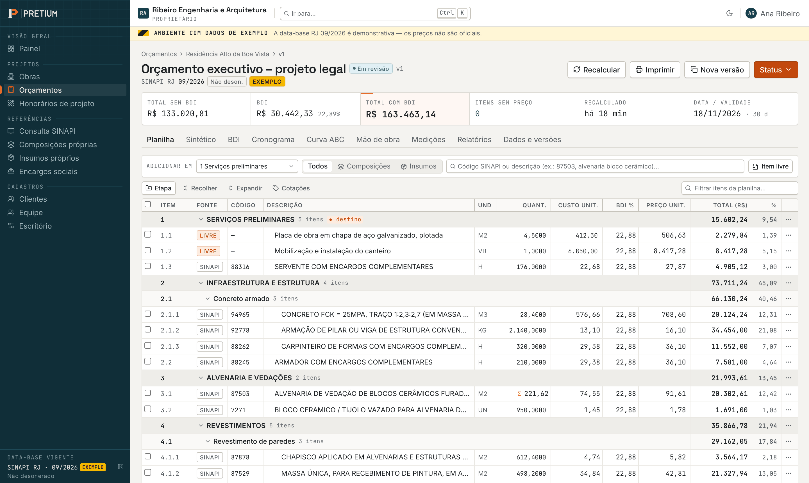

<p align="center"></p>

# Pretium

Sistema web de **orçamento de obras** com base na tabela **SINAPI – Rio de Janeiro**, para
engenheiros e arquitetos: obras, orçamento analítico/sintético com EAP, composições SINAPI e
próprias, BDI (fórmula TCU – Acórdão 2622/2013), encargos sociais, mão de obra, cronograma
físico-financeiro, curva ABC, memória de cálculo, medições, honorários de projeto, relatórios
(impressão/PDF) e exportação CSV/XLSX. Multiusuário com organizações, papéis e um painel de
administração global; segurança por RLS no Supabase.

<p align="center"></p>

Stack: Vite · React 18 · TypeScript (strict) · Tailwind CSS 3 · React Router 6 · TanStack Query ·
zod + react-hook-form · lucide-react · recharts · SheetJS (xlsx) · Supabase (Postgres, Auth, RLS,
RPC, Storage) · Vitest + Testing Library · Playwright (E2E).

> **Dados de exemplo.** O banco vem com uma data-base SINAPI-RJ **de demonstração** (insumos,
> composições e encargos com códigos e descrições no estilo SINAPI, escritos de memória, e **preços
> fictícios**). Eles **não são a tabela oficial da Caixa** e podem não corresponder aos códigos
> vigentes. Tudo o que vem deles é marcado na interface (selo **EXEMPLO** e faixa "Ambiente com
> dados de exemplo") e nos relatórios (faixa "DOCUMENTO GERADO COM DADOS DE EXEMPLO – NÃO
> OFICIAIS"). Antes de usar o sistema para valer, importe a tabela oficial (veja
> [Tabela SINAPI oficial](#tabela-sinapi-oficial)).

## Documentação

| Documento | Conteúdo |
|---|---|
| [`docs/ENTREGA.md`](docs/ENTREGA.md) | **guia do usuário**: módulos, papéis, primeiro acesso, fluxo de orçamento, limitações, checklist da revisão final |
| [`docs/ARQUITETURA.md`](docs/ARQUITETURA.md) | módulos, modelo de dados, RLS/permissões, RPCs, regras de cálculo, formato SINAPI |
| [`docs/DESIGN.md`](docs/DESIGN.md) | tokens de cor (claro/escuro), tipografia, componentes, telas estreitas, acessibilidade |
| [`docs/RELATORIO_TESTES.md`](docs/RELATORIO_TESTES.md) | ambiente, cobertura e resultados dos testes |
| [`docs/CONTRATO_ALTERACOES.md`](docs/CONTRATO_ALTERACOES.md) | registro de mudanças de contrato |
| [`docs/DIVISAO_TRABALHO.md`](docs/DIVISAO_TRABALHO.md) | responsabilidades por agente durante o desenvolvimento |

## Requisitos

- Node.js 20+ e npm 10+
- [Supabase CLI](https://supabase.com/docs/guides/local-development/cli/getting-started) (2.x ou 3.x;
  `npx supabase` também funciona) e Docker, para o banco local, **ou** um projeto no
  [supabase.com](https://supabase.com)

## Como rodar (desenvolvimento)

```bash
npm install
supabase start                       # sobe Postgres, Auth, Storage, Studio (http://localhost:54323)
supabase db reset                    # aplica supabase/migrations/* em ordem e roda supabase/seed.sql
cp .env.example .env.local           # preencha com a "API URL" e a "anon key" de `supabase status`
npm run dev                          # http://localhost:5173
```

Abra o app e **crie a primeira conta: ela vira administradora** (enquanto `admin_emails` estiver
vazio e não houver nenhum admin). As contas seguintes ficam "aguardando aprovação" até o admin
aprovar em **Administração → Usuários**.

E-mails de autenticação locais (recuperação de senha) aparecem no Inbucket/Mailpit:
http://localhost:54324. Sem acesso ao registro ECR da AWS, use as imagens do Docker Hub:
`SUPABASE_INTERNAL_IMAGE_REGISTRY=docker.io supabase start`. Use **a mesma versão do CLI** para
`start` e `db reset`: um `db reset` feito por um CLI mais novo recria o banco com uma imagem do
Postgres cujo schema de Storage não combina com o container de Storage já em execução (o upload
de arquivos passa a falhar).

## Antes de ir para produção (obrigatório)

1. **Defina quem é administrador.** A regra "o primeiro cadastro vira admin" é prática no
   desenvolvimento, mas em produção qualquer pessoa que chegue primeiro à tela de cadastro viraria
   admin. Antes de divulgar o endereço, rode no SQL Editor do Supabase:
   ```sql
   update configuracoes set valor = '["voce@empresa.com.br"]' where chave = 'admin_emails';
   ```
   Com a lista preenchida, **somente** esses e-mails viram admin. Alternativa: feche o cadastro
   (`update configuracoes set valor = 'false' where chave = 'cadastro_aberto';`) e cadastre-se
   antes de fechar, ou faça os dois. Depois de logado, o admin ajusta tudo isso em
   **Administração → Configurações**.
2. **Ligue a confirmação de e-mail** (*Authentication → Sign In / Providers → Email → Confirm email*).
   O aceite de convites de organização e a regra `admin_emails` confiam no e-mail da conta; sem
   confirmação, alguém poderia se cadastrar com um e-mail que não é seu. Configure também um SMTP
   próprio (*Authentication → Emails → SMTP Settings*): o servidor de e-mail padrão do Supabase tem
   limite baixo de envios e serve só para testes.
3. Mantenha **Max rows** da API (*Project Settings → Data API*) em **1000 ou mais** (o padrão é
   1000). O app pagina as leituras grandes em lotes de 1000.
4. Importe a tabela SINAPI oficial e publique a data-base (abaixo) — só então os orçamentos deixam
   de ser "de exemplo".

## Deploy no Supabase Cloud + hospedagem estática

### 1. Banco (Supabase)

1. Crie o projeto em [supabase.com/dashboard](https://supabase.com/dashboard) (região sugerida:
   *South America (São Paulo)*). Guarde a senha do banco.
2. No terminal, na pasta do projeto:
   ```bash
   npx supabase login                               # abre o navegador para autenticar
   npx supabase link --project-ref <ref-do-projeto> # o "ref" está na URL do painel
   npx supabase db push                             # aplica supabase/migrations/* (0001 → 0031)
   ```
3. **Dados de demonstração (opcional)** — útil para conhecer o sistema; dispensável se você já vai
   importar a tabela oficial:
   ```bash
   npx supabase db push --include-seed              # CLI recente; ou:
   psql "<connection string do painel: Project Settings → Database>" -f supabase/seed.sql
   ```
   O seed não cria usuários nem organizações.
4. *Authentication → URL Configuration*: em **Site URL** coloque o endereço público do app
   (ex.: `https://orcamentos.suaempresa.com.br`) e em **Redirect URLs** adicione
   `https://<seu-domínio>/login`, `https://<seu-domínio>/redefinir-senha` e
   `https://<seu-domínio>/convite/**`.
5. Faça os passos de [Antes de ir para produção](#antes-de-ir-para-produção-obrigatório).
6. Anote em *Project Settings → API* a **Project URL** e a chave **anon public** (ou *publishable*).
   Nunca use a `service_role`/*secret* no front.

### 2. Front (build estático)

Variáveis de ambiente (lidas **no build** pelo Vite):

| Variável | Valor |
|---|---|
| `VITE_SUPABASE_URL` | Project URL, ex.: `https://abcd1234.supabase.co` |
| `VITE_SUPABASE_ANON_KEY` | chave anon/publishable do projeto |

```bash
npm ci
VITE_SUPABASE_URL=... VITE_SUPABASE_ANON_KEY=... npm run build   # gera dist/
npm run preview                                                  # confere localmente
```

O resultado (`dist/`) é um site estático de página única (SPA): o servidor precisa devolver
`index.html` para qualquer rota (ex.: `/orcamentos/123`).

- **Vercel**: importe o repositório; o [`vercel.json`](vercel.json) já define build (`npm run build`),
  saída (`dist`) e o fallback SPA. Cadastre as duas variáveis em *Settings → Environment Variables*
  e faça o deploy.
- **Netlify** / **Cloudflare Pages**: build `npm run build`, diretório de publicação `dist`, as duas
  variáveis no painel. O arquivo [`public/_redirects`](public/_redirects) (`/* /index.html 200`)
  vai para `dist/` e cuida do fallback SPA.
- Outro servidor (Nginx, S3 + CloudFront…): sirva `dist/` e configure o fallback para `/index.html`.

Depois do primeiro deploy, acesse o endereço, cadastre-se com um e-mail de `admin_emails` e
siga o [guia do usuário](docs/ENTREGA.md).

## Tabela SINAPI oficial

O banco **não** traz preços oficiais. Para usá-los:

1. Baixe no site da Caixa (*caixa.gov.br → Downloads → SINAPI*) os arquivos do mês desejado para a
   **UF RJ**, nos regimes **não desonerado** e/ou **desonerado**. São aceitos:
   - o formato **por UF** (um arquivo por tipo: `…_Insumos_RJ_AAAAMM_…`,
     `…_Composicoes_Sintetico_RJ_…`, `…_Composicoes_Analitico_RJ_…`);
   - a **planilha consolidada mensal** (abas `ISD`/`ICD` de insumos, `CSD`/`CCD` de composições e
     `Analítico`, com uma coluna de preço por UF).

   Detalhes de colunas aceitas: [`docs/ARQUITETURA.md` §9](docs/ARQUITETURA.md#9-importação-sinapi-formato-da-planilha).
2. Entre como admin em **Administração → Importar SINAPI**. Para cada arquivo, nesta ordem:
   **insumos → composições (sintético) → analítico**:
   - escolha UF (RJ), mês/ano e regime (o sistema sugere a partir do nome do arquivo);
   - confira a detecção do cabeçalho, o mapeamento de colunas e a prévia (linhas com erro aparecem
     destacadas);
   - envie. A leitura é feita no navegador e as linhas vão ao banco em lotes de 1000.
3. No **último** arquivo de cada mês/regime, marque **Publicar a data-base ao concluir** (ou publique depois em
   **Administração → Tabelas SINAPI**). Só datas-base publicadas aparecem para os usuários.
4. Com a data-base oficial publicada, arquive as datas-base de exemplo em
   **Administração → Tabelas SINAPI** e, nos orçamentos existentes, troque a data-base em
   **Orçamento → Dados e versões** (todos os itens são recalculados).

## Scripts

| Script | Ação |
|---|---|
| `npm run dev` | servidor de desenvolvimento |
| `npm run build` | checagem de tipos + build de produção em `dist/` |
| `npm run preview` | serve o build |
| `npm run typecheck` | `tsc -b` |
| `npm run lint` | ESLint |
| `npm test` | testes unitários e de componente (vitest + Testing Library) |
| `npm run test:db` | suítes SQL (RLS, RPCs, cálculo, importação) em Postgres WASM (PGlite) — não precisa de Docker |
| `npm run test:db:pg` | as mesmas suítes num Postgres real via `psql` (padrão: o do `supabase start`, porta 54322) |
| `npm run test:contrato` | verificador estático: toda chamada `from/select/rpc/storage` de `src/` × catálogo do banco migrado |
| `npm run test:integracao` | hooks reais de `src/api` contra o Supabase local (GoTrue + PostgREST + Storage); `-- --reset` faz `supabase db reset` antes |
| `npm run test:e2e` | Playwright (Chromium) no build de produção contra o Supabase local; screenshots em `test-results/e2e/` |
| `npm run test:all` | tudo acima |
| `npm run types:gen` | gera `src/types/database.generated.ts` a partir do banco local (conferência) |
| `npm run db:start` / `db:reset` | atalhos do Supabase CLI |

Os passos que dependem do Supabase local, do `psql` ou do Playwright são **pulados com aviso** se
o recurso não estiver disponível. Para exigir que tudo rode (CI, entrega):

```bash
PRETIUM_INTEGRACAO=obrigatorio PRETIUM_E2E=obrigatorio PRETIUM_PG=obrigatorio npm run test:all
```

Relatório da última rodada: [`docs/RELATORIO_TESTES.md`](docs/RELATORIO_TESTES.md).

## Estrutura

```
public/                 logo.svg, logo-dark.svg, logo-mark*.svg, favicon.svg, _redirects (SPA)
src/
  App.tsx               roteamento completo
  routes.ts             construtores de caminhos
  components/ui/        design system (Button, Input, Table, Card, Modal, Tabs, …)
  components/layout/    AppShell, Sidebar, Topbar
  components/brand/     Logo
  contexts/             Auth, Organização, Tema
  api/                  hooks react-query (core/, orcamento/)
  lib/                  supabase, format, calc (regras de cálculo), labels, export, sinapi
  pages/                telas por módulo
  types/                tipos do banco (contrato com as migrações)
supabase/
  migrations/           0001–0009 núcleo · 0010–0022 SINAPI/orçamento · 0030+ correções e endurecimento
  seed.sql              dados de demonstração (data-base SINAPI-RJ de exemplo)
  tests/                suítes SQL (PGlite / Postgres real)
  config.toml
scripts/                verificador de contrato, integração e E2E
docs/                   documentação e screenshots
```
