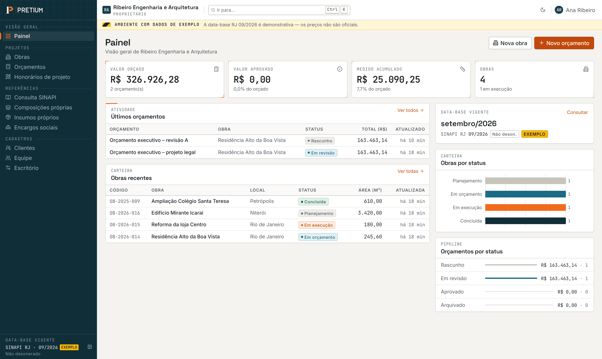
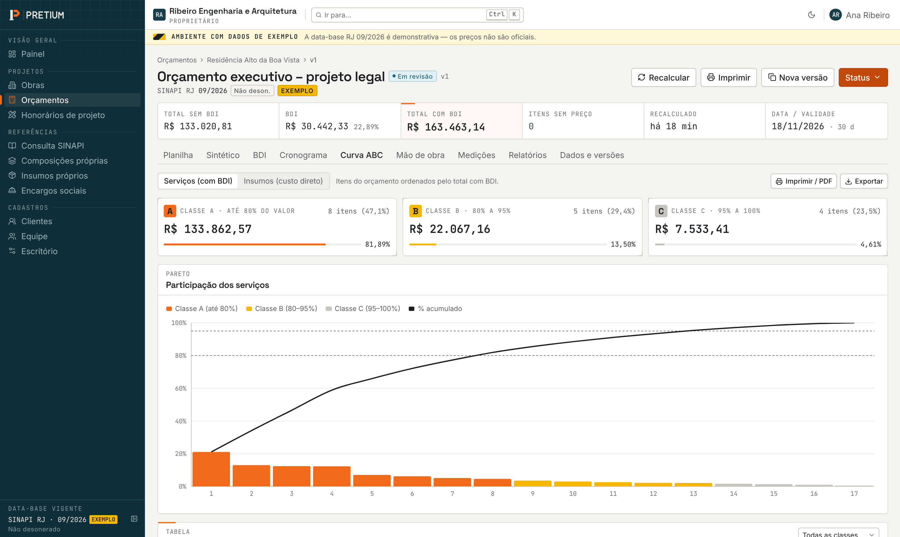
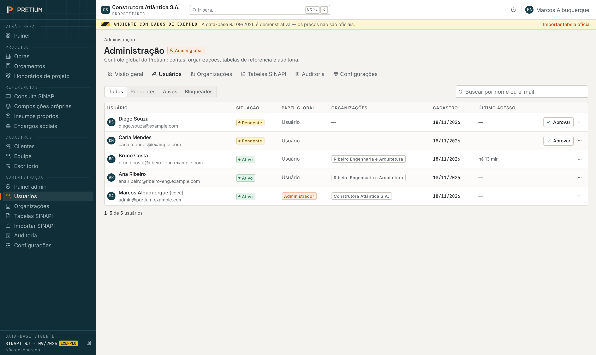

# Pretium: guia de entrega

Este documento é o guia de uso para o escritório que vai operar o Pretium. No fim estão as
limitações conhecidas e o checklist da revisão final. Para instalação e deploy, veja o
[README](../README.md).

## 1. O que o sistema faz

O Pretium monta **orçamentos de obras** com a tabela **SINAPI (Caixa), UF Rio de Janeiro**. Ele cobre
o trabalho do engenheiro e do arquiteto de ponta a ponta:

- cadastro de clientes e obras;
- orçamento analítico com EAP (etapas, subetapas e itens);
- BDI pela fórmula do TCU;
- composições próprias;
- memória de cálculo;
- cronograma físico-financeiro;
- curva ABC;
- mão de obra;
- medições;
- honorários de projeto;
- relatórios impressos (PDF) e planilhas (XLSX/CSV).

Vários escritórios (organizações) usam a mesma instalação, e cada um vê **somente os próprios
dados**. Um **administrador global** controla contas, organizações, tabelas SINAPI, configurações e
auditoria.

## 2. Papéis e permissões

| Papel | Quem é | O que pode |
|---|---|---|
| **Administrador global** | Responsável pela instalação | Tudo, em qualquer organização: aprova, bloqueia e promove usuários; bloqueia organizações e adiciona membros; importa e publica tabelas SINAPI; altera configurações; lê toda a auditoria. |
| **Proprietário** (da organização) | Sócio ou titular do escritório | Tudo na organização, mais: dados e logo do escritório, convites, papéis e remoção de membros, auditoria da organização. |
| **Editor** | Orçamentista, projetista | Cria, edita e exclui clientes, obras, orçamentos, composições e insumos próprios, encargos e honorários. |
| **Leitor** | Estagiário, cliente, fiscal | Só consulta, imprime e exporta. |

A conta pode estar em três situações:

- **Pendente:** cadastrou-se e aguarda aprovação. Não vê dados.
- **Ativa.**
- **Bloqueada:** perde o acesso na hora, mesmo com a sessão aberta.

Uma organização bloqueada pelo administrador fica somente leitura.

As permissões são garantidas pelo próprio banco de dados (RLS do Supabase), não apenas pelas telas.
Mesmo quem tentar acessar a API diretamente não lê nem altera dados de outra organização.

## 3. Primeiro acesso

1. **Para ser administrador:** em produção, o responsável técnico pela instalação coloca o seu e-mail
   na configuração `admin_emails` antes de divulgar o endereço (README, "Antes de ir para
   produção"). Ao se cadastrar com esse e-mail, a conta já nasce administradora e ativa. Sem lista
   definida, o **primeiro** cadastro da instalação vira administrador.
2. **Demais pessoas:** clicam em "Criar conta" e ficam pendentes até o administrador aprovar em
   **Administração → Usuários** (botão **Aprovar**). A aprovação pode ser desligada em
   **Administração → Configurações** (opção "Exigir aprovação").
3. **Criar o escritório:** no primeiro acesso, a pessoa cria a organização (nome e CNPJ) e vira
   **proprietária**. Em **Escritório**, preenche os dados que vão nos relatórios: responsável técnico,
   CREA/CAU, endereço e logo.
4. **Convidar a equipe:** em **Equipe → Convidar**, informe o e-mail e o papel. O sistema gera um
   **link de convite**: copie pelo ícone e envie à pessoa. Ela entra (ou se cadastra) **com o mesmo
   e-mail** e aceita o convite. O convite vale 7 dias (configurável). Quem tem convite consegue se
   cadastrar mesmo com o cadastro fechado.

## 4. Módulos

### Painel
Mostra os indicadores da organização: valor orçado, valor aprovado, medido acumulado e obras por
status. Também lista os últimos orçamentos e as obras recentes, os orçamentos por status e a
data-base vigente.

### Obras e clientes
- **Clientes:** pessoa física ou jurídica, com CPF/CNPJ validado, contato e endereço.
- **Obras:** código, cliente, endereço, áreas, datas previstas, responsável técnico e ART/RRT.
  A ficha da obra reúne as versões de orçamento e as propostas de honorários.

### Orçamento
Cada orçamento pertence a uma obra e tem **data-base** (SINAPI RJ, mês/ano, regime desonerado ou
não desonerado), **status** (rascunho → em revisão → aprovado → arquivado) e **versões**. Orçamentos
aprovados ou arquivados ficam somente leitura; para alterar, use **Nova versão**. As abas são:

- **Planilha (analítico):** EAP em até 3 níveis, com numeração automática (1, 1.1, 1.1.1).
  - **Incluir itens:** busque por código SINAPI ou descrição (sem acento, sem maiúsculas) ou crie um
    **item livre**.
  - **Editar:** quantidade e custo direto na célula. Enter grava e desce para a linha seguinte; Esc
    desfaz.
  - **Totais:** são recalculados automaticamente.
  - **Menu "…" de cada item:**
    - memória de cálculo (expressões como `(4,5+3,2)*2,8`, com descontos);
    - composição analítica;
    - custo manual;
    - mover;
    - excluir.
  - **Cotações:** substituem o preço SINAPI de um insumo só neste orçamento.
- **Sintético:** totais por etapa com percentual. Pode ser recolhido por nível.
- **BDI:** fórmula do TCU (Acórdão 2622/2013), com AC, S, R, G, DF, L e os tributos PIS, COFINS, ISS
  e CPRB.
  - **Presets:** 1º quartil, médio e 3º quartil.
  - **Faixas do TCU:** cada parcela mostra a faixa de referência, e o sistema avisa quando o BDI sai
    dela.
  - **ISS:** calculadora de ISS efetivo (alíquota × base de mão de obra).
  - **BDI diferenciado:** para itens específicos, como fornecimento de equipamentos.
- **Cronograma:** físico-financeiro, com percentual por etapa e período (semanal, quinzenal ou
  mensal), totais por período, acumulado e curva S.
- **Curva ABC:** de serviços (com BDI) e de insumos (composições "explodidas" até o insumo), com as
  classes A (80%), B (15%) e C (5%) e o gráfico de Pareto.
- **Mão de obra:** equipes com função, quantidade, horas/dia, dias e custo-hora (salário + encargos
  sociais, ou insumo SINAPI). Mostra o histograma de horas-homem e as horas de mão de obra
  implícitas nas composições.
- **Medições:** boletins por período, criados a partir do status "em revisão". Mostram quantidade
  anterior, do período, acumulada e saldo, em quantidade e valor. Boletins fechados ficam somente
  leitura.
- **Relatórios:** central de impressão e exportação (seção 6).
- **Dados e versões:** dados do orçamento, troca de data-base (recalcula todos os itens),
  duplicação e histórico de versões.

### Referências
- **Consulta SINAPI:** pesquisa de insumos e composições com preço na data-base. As composições
  abrem a ficha analítica.
- **Composições próprias:** serviços do escritório, montados com insumos e composições SINAPI ou
  próprias. O custo é calculado sobre a data-base de cada orçamento.
- **Insumos próprios:** materiais e serviços com preço do escritório, usados quando não há preço
  SINAPI.
- **Encargos sociais:** tabelas horista e mensalista (grupos A a D). As de referência são somente
  leitura; para ajustar, use **Copiar**.

### Honorários de projeto
Propostas por disciplina (arquitetônico, estrutural, instalações etc.). Cada disciplina tem um
método de cálculo: por área (R$/m²), percentual do custo da obra, horas técnicas ou valor fixo. A
proposta tem desconto, impostos "por dentro", prazo, condições de pagamento e impressão.

### Administração (só admin)
- **Visão geral:** indicadores e fila de solicitações de acesso.
- **Usuários:** aprovar, bloquear (com motivo), reativar e promover ou rebaixar administradores.
- **Organizações:** bloquear ou desbloquear, ver e adicionar membros.
- **Tabelas SINAPI:** datas-base (publicar, voltar para rascunho, arquivar) e histórico de
  importações.
- **Importar SINAPI:** assistente de importação (seção 5).
- **Auditoria:** quem fez o quê e quando, com filtros e comparação antes/depois.
- **Configurações:** cadastro aberto ou fechado, aprovação obrigatória, e-mails de administradores,
  UF padrão, validade de convites e aviso global (faixa no topo para todos os usuários).

## 5. Importação da tabela SINAPI

1. Baixe no site da Caixa os arquivos do mês (UF RJ, não desonerado e/ou desonerado). O sistema
   aceita o formato por UF e a planilha consolidada mensal.
2. Em **Administração → Importar SINAPI**, importe um arquivo por vez, **nesta ordem: insumos →
   composições (sintético) → analítico**. Para cada arquivo:
   - confira UF, mês/ano e regime (sugeridos pelo nome do arquivo);
   - confira o mapeamento de colunas;
   - confira a prévia: linhas inválidas aparecem com o motivo e não são enviadas.
3. No último arquivo, marque **Publicar a data-base ao concluir**. Só datas-base publicadas aparecem
   nos orçamentos.
4. Arquive as datas-base de exemplo e, nos orçamentos já existentes, troque a data-base em
   **Dados e versões**.

## 6. Relatórios e exportação

Os relatórios impressos são gerados em A4 com o cabeçalho do escritório (logo, obra, cliente,
data-base, regime e BDI), carimbo técnico e numeração de páginas. Para gerar o PDF, use
"Imprimir / PDF" e escolha "Salvar como PDF" na janela de impressão. Estão disponíveis:

- orçamento sintético;
- orçamento analítico;
- composições de custo unitário;
- curva ABC de serviços e de insumos;
- cronograma físico-financeiro (paisagem);
- memória de cálculo;
- boletim de medição;
- proposta de honorários.

A exportação gera **XLSX** (números como números, formato brasileiro) ou **CSV** (separador `;`,
vírgula decimal, abre direto no Excel). Também há a "pasta de trabalho completa", com todas as abas
num único arquivo.

**Dados de exemplo:** enquanto a data-base for a de demonstração, a tela mostra a faixa
"Ambiente com dados de exemplo" e o selo **EXEMPLO**. Os relatórios e as planilhas exportadas
levam o aviso "DOCUMENTO GERADO COM DADOS DE EXEMPLO – NÃO OFICIAIS". Os códigos da demonstração
foram escritos de memória e os preços são fictícios. **Não use esses documentos em propostas ou
contratos.**

## 7. Fluxo típico de um orçamento

1. Cadastre o **cliente** e a **obra**.
2. Em **Orçamentos → Novo orçamento**, escolha a obra, a data-base e um preset de BDI do TCU.
3. Na **Planilha**, crie as etapas (Serviços preliminares, Infraestrutura, Alvenaria…) e inclua os
   serviços pela busca SINAPI. Digite as quantidades ou use a **memória de cálculo**.
4. Ajuste o **BDI** (e os BDIs diferenciados, se houver) e as **cotações** de insumos com preço de
   mercado.
5. Confira o **Sintético** e a **Curva ABC**: os itens da classe A merecem revisão de quantidade e
   preço.
6. Distribua o **Cronograma** e dimensione a **Mão de obra**.
7. Mude o status para **Em revisão** e depois **Aprovado**. Imprima os relatórios.
8. Na execução, registre as **Medições** por período. Para mudanças de escopo, crie uma
   **Nova versão**.
9. Em paralelo, monte a proposta de **Honorários** de projeto da mesma obra.

## 8. Limitações conhecidas

- **Tabela SINAPI:** a instalação não baixa a tabela da Caixa sozinha. A importação é manual, mês a
  mês. Os formatos aceitos são os publicados até a data desta entrega; se a Caixa mudar o layout,
  ajuste o mapeamento de colunas na tela de importação. Se isso não bastar, o parser precisará de
  atualização.
- **Faixas e presets do BDI:** reproduzem o Acórdão 2622/2013 do TCU para "construção de edifícios"
  e "fornecimento de materiais". Confira com o texto do acórdão antes de uso contratual. A
  alíquota de CPRB é digitada pelo usuário (a reoneração gradual da Lei 14.973/2024 muda o valor
  ano a ano).
- **Convites:** o sistema não envia e-mail de convite. O proprietário copia o link e o envia por
  conta própria. O e-mail do sistema serve apenas para confirmação de cadastro e recuperação de
  senha, e exige SMTP configurado no Supabase.
- **Edição simultânea:** duas pessoas editando o mesmo orçamento ao mesmo tempo não veem as
  alterações uma da outra em tempo real (não há Realtime). Prevalece a última gravação de cada
  campo, e o "Recalcular" consolida os totais.
- **Profundidade da EAP:** a EAP tem no máximo 3 níveis.
- **Orçamentos muito grandes:** a planilha carrega tudo em lotes de 1000 itens (testado com mais de
  5.000). Acima de alguns milhares de itens, a tela fica mais lenta, porque não há virtualização de
  linhas.
- **Navegadores:** testado em Chromium (desktop e 390 px). Firefox e Safari não foram testados
  automaticamente. O seletor de data usa o formato do navegador.
- **Leitor de tela:** os rótulos ARIA estão presentes, mas não houve auditoria completa com leitor de
  tela.
- **Logos em SVG:** são aceitos para o escritório e o avatar. São exibidos como imagem (sem executar
  scripts), mas o arquivo original fica no Storage. Prefira PNG.

## 9. Checklist da revisão final

Revisão feita sobre o código completo (migrações, front, testes e documentação), com o app real
rodando contra o Supabase local, nos papéis de admin e de usuária comum, nos temas claro e escuro,
em 1366/1440 px e 390 px.

### Segurança

| Verificação | Resultado |
|---|---|
| RLS ligada em todas as 30 tabelas do schema `public`, todas com políticas | ✔ |
| Funções `SECURITY DEFINER` com `search_path` fixo | **Corrigido**: as funções de B2 usavam `public` (com `pg_temp` implícito antes); agora `public, pg_temp`. As funções puras sem `search_path` também foram fixadas (migração 0031). |
| RPCs executáveis por `anon` | **Corrigido**: 13 funções eram executáveis sem login; agora 0. Os privilégios padrão também não concedem mais a funções futuras. |
| Escalonamento de privilégio (`papel_global`/`status` via PATCH, auto-aprovação, organização ativa alheia) | ✔ bloqueado por trigger; coberto por testes de integração |
| SQL dinâmico | ✔ somente com `format(%I/%L)` e nomes fixos das migrações |
| Storage (logos, avatares, sinapi-arquivos) | ✔ escrita restrita a owner/próprio/admin, leitura por membro; URLs assinadas |
| `supabase db lint` (plpgsql_check) | ✔ sem achados (eram 2 avisos de variável não usada, corrigidos) |
| Primeiro cadastro vira admin / confirmação de e-mail | Documentado como passo obrigatório de produção no README |

### Correção

| Verificação | Resultado |
|---|---|
| BDI TCU, arredondamento por item, totais, honorários: `calc.ts` × SQL | ✔ (integração compara o front com o banco) |
| Curva ABC, cronograma, medições, mão de obra | ✔ suítes SQL em PGlite, PG 15 e PG 16 |
| Orçamento com mais de `max_rows` itens | **Corrigido**: `useItens` e as demais leituras grandes vinham truncadas em 5000 linhas (1000 no Supabase Cloud). Agora paginam por `range` (`buscarTodas`). Teste de integração com 5.120 itens e testes unitários. |
| Edição de quantidade "não gravada" (instabilidade do E2E) | **Bug real corrigido**: depois do Enter, o foco ia para a linha seguinte antes da atualização otimista, e o blur **reenviava o valor anterior**, desfazendo a edição (reproduzido em 4 de 10 tentativas). Além disso, um refetch podia apagar o texto em digitação. O `NumberInput` agora emite cada valor uma única vez e não sobrescreve o campo com foco. Há testes de regressão e o E2E passou a ser estrito (1 tentativa, exatamente 1 PATCH). |
| "Último acesso" dos usuários | **Corrigido**: a chamada `registrar_acesso` dentro do `onAuthStateChange` nunca era enviada no navegador (trava do lock do supabase-auth). Agora é adiada para depois do callback. |
| Boletim de medição | **Corrigido**: itens diretos da etapa apareciam antes das subetapas (2.2 antes de 2.1). Agora segue a ordem da EAP, com recuo por nível. |
| Painel: "Medido acumulado" | **Corrigido**: mostrava "Sem medições" quando havia medição em orçamento não aprovado. |
| Exportações (ABC, cronograma, medição) | **Corrigido**: também vinham truncadas; agora paginadas |

### Interface

| Verificação | Resultado |
|---|---|
| Tipografia pequena, mono tabular nos números, cantoneiras e filetes, paleta de obra | ✔ consistente nos dois temas |
| Campos do BDI desalinhados por rótulos longos | **Corrigido** (rótulos curtos com nome completo acessível) |
| Honorários: legendas quebrando e desalinhando a tabela; tabela espremida no celular | **Corrigido** |
| Cabeçalhos ordenáveis sem caixa alta (diferentes dos demais) | **Corrigido** |
| Select com seta fora da caixa (Configurações) e sufixo "dias" sobre o número | **Corrigido** |
| Filtro "Todas as classes" cortado na curva ABC | **Corrigido** |
| Celular (390 px): códigos quebrando em 3 linhas, KPIs quebrando, faixa de exemplo em 3 linhas | **Corrigido** |
| Textos técnicos expostos ao usuário (nomes de funções do banco, "trigger", "coluna gerada") | **Removidos** |
| Auditoria mostrava nomes de tabela e o filtro não tinha as entidades de orçamento | **Corrigido** (rótulos em português, lista completa) |
| Menu de administração sem Organizações e Configurações | **Corrigido** |
| Foco visível por teclado, estados vazios, carregamento e erro de formulário | ✔ |
| Logomarca e favicon em 16–96 px, claro e escuro | ✔ nítidos |
| Selo e faixa de dados de exemplo na interface, impressão e XLSX/CSV | ✔ |

### Código e repositório

- Código morto removido (`useMedicaoItens`, `somaItens`) e variáveis de ambiente sem uso removidas
  do `.env.example`.
- Nenhum `console.log`, segredo ou arquivo temporário versionado.
- `.gitignore` cobre `.env*`, `dist`, `test-results`, `supabase/.temp`, `supabase/.branches` e os
  tipos gerados.
- Adicionados `vercel.json` e `public/_redirects` (fallback de SPA).

### Verificações finais

Todas executadas com `PRETIUM_INTEGRACAO=obrigatorio PRETIUM_E2E=obrigatorio PRETIUM_PG=obrigatorio`
(nada pulado), todas passando:

| Verificação | Resultado |
|---|---|
| `typecheck` · `lint` · `build` | sem erros |
| Unitários e componentes (vitest) | 97/97 |
| SQL no PGlite (núcleo parcial, núcleo completo, orçamento) | 167/167 · 167/167 · 249/249 |
| SQL no Postgres 15.8 do Supabase | 416/416 |
| Contrato frontend × banco | OK |
| Integração com GoTrue/PostgREST/Storage reais | 42/42 |
| E2E Playwright (claro/escuro, admin e usuária, 390 px, impressão) | 87 visitas, 0 problemas |

Detalhes em [`RELATORIO_TESTES.md`](RELATORIO_TESTES.md) §7.

### Screenshots

[`screenshots/`](screenshots/): `login.png`, `painel.png`, `planilha.png`, `bdi.png` (tema escuro),
`curva-abc.png` e `admin.png`. Todos com dados de demonstração.
